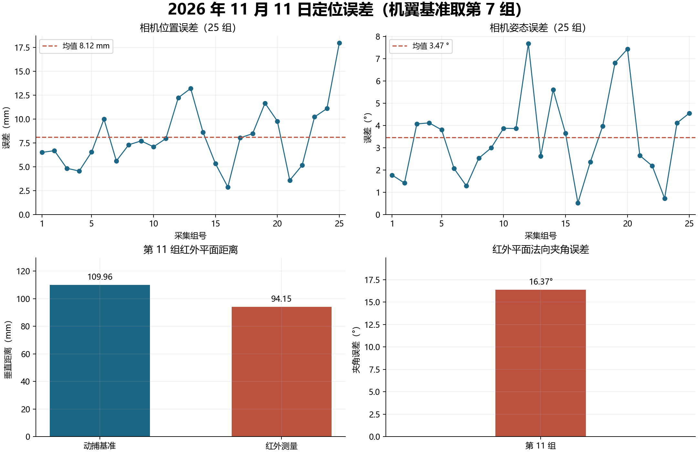
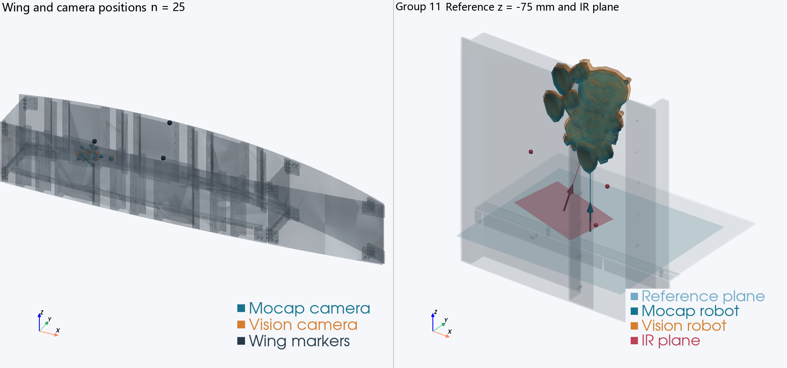

# 2026 年 11 月 11 日相机与红外定位精度分析

CSV 与动捕 MAT 各含 25 组，按 CSV 组号和 MAT 行号对应。实验期间机翼标记位置固定，采用第 7 组的三个机翼标记建立统一动捕基准。第 1–25 组均可评估视觉位姿，红外仅第 11 组有有效平面。

| 指标 | 有效组数 | 均值 | RMSE | 中位数 | P95 | 最大值 |
|---|---:|---:|---:|---:|---:|---:|
| 相机位置误差（mm） | 25 | 8.118 | 8.770 | 7.707 | 13.002 | 17.965 |
| 相机姿态误差（°） | 25 | 3.466 | 3.939 | 3.645 | 7.310 | 7.674 |
| 红外距离绝对误差（mm） | 1 | 15.804 | 15.804 | 15.804 | — | 15.804 |
| 红外法向夹角误差（°） | 1 | 16.368 | 16.368 | 16.368 | — | 16.368 |

第 11 组的红外平面距离为 94.155 mm，动捕参考距离为 109.959 mm，距离偏差为 -15.804 mm。法向夹角为 16.368°。红外统计只反映这一组。

视觉位置误差最大的是第 25 组（17.965 mm），姿态误差最大的是第 12 组（7.674°）。视觉相对动捕参考的 XYZ 平均偏差为 (-2.222, +1.816, -4.661) mm。

## 配准与误差口径

对第 7 组的 3 个机翼标记点遍历 6 种对应，按 Kabsch 刚体拟合残差选择对应并计算动捕系到机翼系的变换。该变换应用于每组各自的机器人标记。机器人点先去重，再遍历所有对应。只有 3 个唯一点时遍历 4 选 3 的 4 个子集及各自的 6 种排列。对机器人候选位姿，要求前向射线与机翼系 z = −75 mm 平面的交点位于前方，再选择残差最小的候选。对应关系仅由标记点及该几何约束确定。本批用于评价的各组去重后均有 4 个机器人标记点，第 23 组删除了一个重复点。

动捕机器人位姿经相机安装外参换算为相机参考位姿，光心偏移为 (0, −29.5, 4) mm。位置误差取机翼系内两相机光心间的欧氏距离，姿态误差取相对旋转角。红外距离比较机器人前端盖原点到两个平面的垂直距离，法向夹角按无向平面法向计算。

第 7 组机翼标记的配准点残差 RMS 为 4.215 mm，名义与实测边长的最大绝对差为 6.924 mm。各组原始机翼点的边长另存用于诊断。
MAT 没有逐组时间戳，按组序匹配依赖采集时样机姿态保持一致。视觉位姿直接取原始 CSV，其中 25 组均使用同一组固定内参，逐帧对焦读数为空。

## 输出文件

- [逐组误差与状态](per_group_errors.csv)保留全部组号，未评价项留空。
- [汇总指标](summary_metrics.csv)、[动捕位姿与红外几何](poses.json)、[机器人标记候选](robot_correspondence_candidates.csv)和[机翼标记边长诊断](wing_marker_edge_diagnostics.csv)用于复核。
- 在实验目录运行 `python analyze_20261111.py` 可重算。

