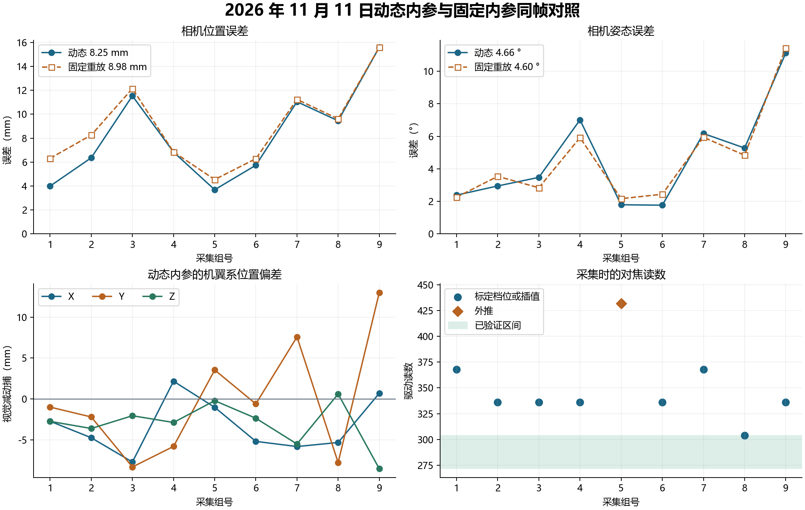
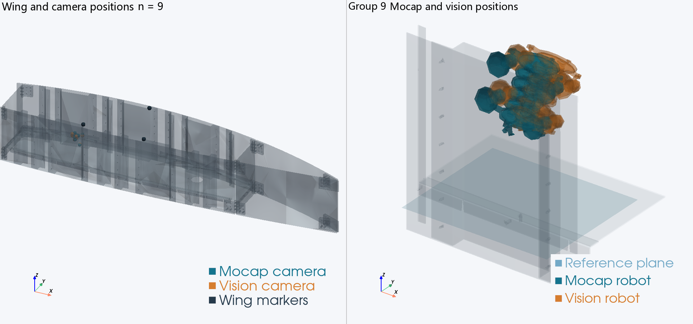

# 2026 年 11 月 11 日动态内参定位精度分析

视觉 CSV 的第 1–9 组按组号对应动捕 MAT 第 1–9 组。按实验说明作废动捕第 10 组。机翼标记位置固定，采用本次第 7 组机翼标记建立统一动捕基准。每组机器人位姿使用该组自己的动捕点。

| 解算方式 | 有效组数 | 平均位置误差（mm） | 位置 RMSE（mm） | 平均姿态误差（°） | 姿态 RMSE（°） |
|---|---:|---:|---:|---:|---:|
| 动态内参原始记录 | 9 | 8.246 | 9.046 | 4.661 | 5.493 |
| 固定内参同帧重放 | 9 | 8.979 | 9.568 | 4.597 | 5.383 |

使用动态内参后，9/9 组的位置误差低于固定内参重放，均值低 0.733 mm。姿态误差均值高 0.064°，4/9 组的姿态误差降低。
动态内参误差最大的为第 9 组，位置误差 15.582 mm，姿态误差 11.120°。

三路红外在全部 9 组均显示 DISCONNECTED，有效红外平面为 0 组。

## 内参与重放口径

逐帧使用的内参与 CSV 和同名快照 JSON 一致。对焦读数 304 有 1 组，336 有 5 组，368 有 2 组，432 有 1 组。304 是已验证的标定点，336 使用尚未通过独立验证的区间插值，368 是尚未通过独立验证的标定点，432 使用线性外推。

两种重放共用原始 CSV 角点、快照 JSON 的检测中心、同一标签地图及加权 PnP。动态重放先复现了 9 组在线位姿，再将 K 和畸变系数替换为此前使用的固定标定参数。位置取三维光心距离，姿态取相对旋转角。动捕 MAT 缺少逐组时间戳，评价依赖视觉与动捕按组采集时姿态一致。

机翼的 3 点匹配遍历全部排列，机器人点去重后遍历全部匹配，选择满足基准平面在前方且残差最小的位姿。若仅有 3 个机器人标记，程序遍历 4 选 3 的所有子集和排列。本次纳入的各组均有 4 个唯一机器人标记。

## 输出文件

- [逐组误差、对焦读数和固定内参重放](per_group_errors.csv)
- [汇总指标](summary_metrics.csv)和[动捕与视觉位姿](poses.json)
- 在本目录运行 `python analyze_dynamic_focus.py` 可重算。

