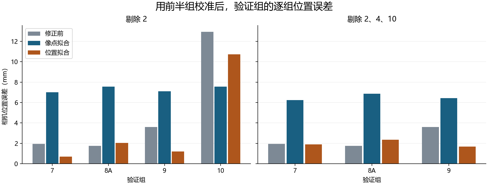

# 11.11 第三次测试 · 5 号标签三维平移校准

基线为新版布局，5 号标签中心的机翼系 XYZ 为 (+334.500, +60.400, -75.000) mm。第 8 组用 8A，动捕机翼系沿用第 7 组机翼标记建立的坐标基准，相机真值由动捕机器人位姿与相机安装外参相乘得到。

像点拟合固定校准组的动捕相机位置和姿态，以快照中 5 号标签的四角、检测中心、逐帧内参和畸变系数拟合机翼系 XYZ 平移。每角权重为 1，中心沿用定位程序配置。另以相机光心三维误差平方和最小为目标做对照，其偏移等于校准组视觉减动捕的平均位置误差取反。

每个方案按采集顺序拆为前、后两半，先用前半拟合并验证后半，再交换角色。每次拟合只用校准组。单标签布局的平移会给所有视觉光心加上同一个向量，视觉姿态误差和视觉 PnP 自身的重投影残差保持不变。表中像点 RMSE 以动捕相机位姿投影标签点后与观测比较，用每点二维残差计算加权 RMSE。

合并两次互换的验证结果，每组只计入一次，使用由另一半数据拟合的偏移。

| 样本 | 拟合目标 | 验证平均位置误差（mm） | 验证位置 RMSE（mm） |
|---|---|---:|---:|
| 全部组 | 固定动捕位姿拟合像点 | 9.119 → 10.144 | 16.412 → 17.224 |
| 全部组 | 拟合相机位置偏差 | 9.119 → 11.719 | 16.412 → 17.617 |
| 剔除 2 | 固定动捕位姿拟合像点 | 4.691 → 5.892 | 5.725 → 6.158 |
| 剔除 2 | 拟合相机位置偏差 | 4.691 → 3.736 | 5.725 → 5.102 |
| 剔除 2、4、10 | 固定动捕位姿拟合像点 | 3.333 → 4.976 | 3.633 → 5.156 |
| 剔除 2、4、10 | 拟合相机位置偏差 | 3.333 → 2.211 | 3.633 → 2.387 |

各次划分的拟合偏移与验证结果如下。

| 样本 | 校准 → 验证 | 拟合目标 | 偏移 ΔX / ΔY / ΔZ（mm） | 验证平均位置误差（mm） | 验证位置 RMSE（mm） | 验证像点 RMSE（px） |
|---|---|---|---:|---:|---:|---:|
| 全部组 | 1,2,3,4,5 → 6,7,8A,9,10 | 固定动捕位姿拟合像点 | (+2.980, +5.588, +3.259) | 5.047 → 6.479 | 6.513 → 6.528 | 30.294 → 22.911 |
| 全部组 | 1,2,3,4,5 → 6,7,8A,9,10 | 拟合相机位置偏差 | (-7.142, +4.926, -0.400) | 5.047 → 10.190 | 6.513 → 10.468 | 30.294 → 61.988 |
| 全部组 | 6,7,8A,9,10 → 1,2,3,4,5 | 固定动捕位姿拟合像点 | (+4.000, +2.662, -1.162) | 13.191 → 13.809 | 22.277 → 23.467 | 43.257 → 25.813 |
| 全部组 | 6,7,8A,9,10 → 1,2,3,4,5 | 拟合相机位置偏差 | (+2.278, +4.041, -1.260) | 13.191 → 13.247 | 22.277 → 22.608 | 43.257 → 24.418 |
| 剔除 2 | 1,3,4,5,6 → 7,8A,9,10 | 固定动捕位姿拟合像点 | (+3.194, +6.699, +3.900) | 5.050 → 7.307 | 6.832 → 7.311 | 23.601 → 30.813 |
| 剔除 2 | 1,3,4,5,6 → 7,8A,9,10 | 拟合相机位置偏差 | (+1.938, +1.468, -0.524) | 5.050 → 3.663 | 6.832 → 5.504 | 23.601 → 12.647 |
| 剔除 2 | 7,8A,9,10 → 1,3,4,5,6 | 固定动捕位姿拟合像点 | (+4.064, +1.563, -2.870) | 4.404 → 4.760 | 4.654 → 5.050 | 48.203 → 33.058 |
| 剔除 2 | 7,8A,9,10 → 1,3,4,5,6 | 拟合相机位置偏差 | (+2.512, +4.055, -0.880) | 4.404 → 3.795 | 4.654 → 4.756 | 48.203 → 24.846 |
| 剔除 2、4、10 | 1,3,5,6 → 7,8A,9 | 固定动捕位姿拟合像点 | (+3.148, +5.625, +3.910) | 2.425 → 6.506 | 2.562 → 6.512 | 24.697 → 26.720 |
| 剔除 2、4、10 | 1,3,5,6 → 7,8A,9 | 拟合相机位置偏差 | (+1.706, +3.057, -1.122) | 2.425 → 1.970 | 2.562 → 1.989 | 24.697 → 16.208 |
| 剔除 2、4、10 | 7,8A,9 → 1,3,5,6 | 固定动捕位姿拟合像点 | (+4.020, +1.649, -2.777) | 4.013 → 3.828 | 4.262 → 3.838 | 42.405 → 24.631 |
| 剔除 2、4、10 | 7,8A,9 → 1,3,5,6 | 拟合相机位置偏差 | (+1.348, +1.618, -0.727) | 4.013 → 2.392 | 4.262 → 2.647 | 42.405 → 31.163 |

枚举近半划分及其交换方向，检查改善是否依赖某一次分组。下表的 RMSE 变化为修正后减修正前，负数表示下降。不同划分复用了同一批数据，结果用于检查分组敏感性。剔除名单来自此前对本批全样本误差的检查，剔除后的验证结果反映保留样本的表现。全部组结果可对照筛选影响。

| 样本 | 拟合目标 | 位置 RMSE 下降的划分 | 位置 RMSE 变化中位数（mm） | 像点 RMSE 下降的划分 |
|---|---|---:|---:|---:|
| 全部组 | 固定动捕位姿拟合像点 | 73/252 | +0.561 | 239/252 |
| 全部组 | 拟合相机位置偏差 | 17/252 | +1.968 | 126/252 |
| 剔除 2 | 固定动捕位姿拟合像点 | 123/252 | +0.100 | 242/252 |
| 剔除 2 | 拟合相机位置偏差 | 183/252 | -0.848 | 252/252 |
| 剔除 2、4、10 | 固定动捕位姿拟合像点 | 27/70 | +0.526 | 67/70 |
| 剔除 2、4、10 | 拟合相机位置偏差 | 65/70 | -1.369 | 70/70 |

每种偏移都由当前批次的一部分样本拟合。结果反映固定平移在本批数据上的校正效果，动捕配准、安装外参和相机内参的偏差也可能进入拟合出的平移。

[逐组验证误差](validation_errors.csv) · [统计与所有划分](summary.json)

