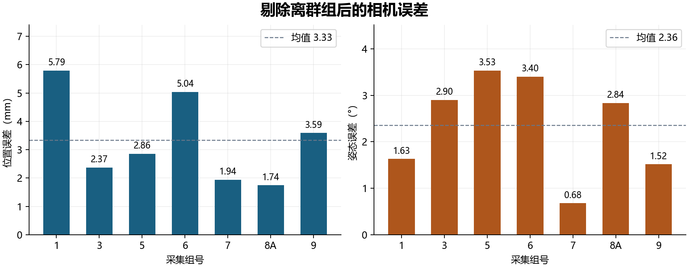
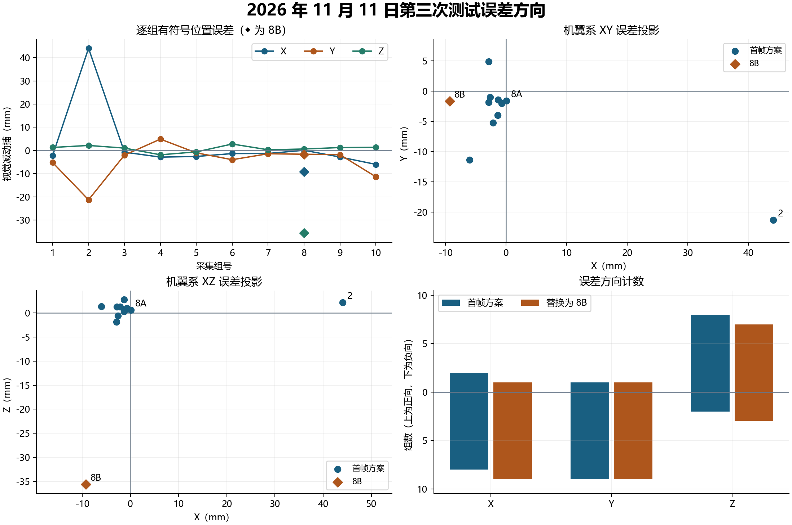
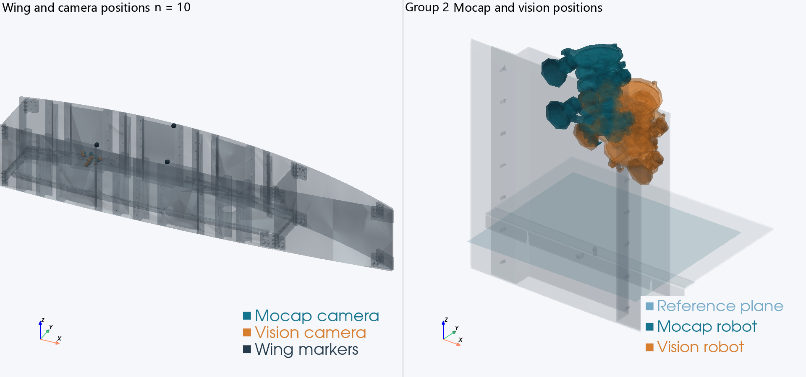

# 2026 年 11 月 11 日第三次定位测试 · 快照重算

## 剔除离群组后的统计

以 8A 主方案的 10 组为样本，分别计算位置和姿态误差的上界 `Q3 + 1.5 × (Q3 − Q1)`。位置上界为 11.070 mm，姿态上界为 8.955°。任一项超过上界即剔除整组，上界只按原样本计算一次。

| 剔除组 | 位置误差（mm） | 姿态误差（°） | 超过上界的指标 |
|---|---:|---:|---|
| 2 | 48.975 | 24.135 | 位置、姿态 |
| 4 | 5.968 | 9.395 | 姿态 |
| 10 | 12.923 | 5.146 | 位置 |

保留 1、3、5、6、7、8A、9 共 7 组。平均位置误差 **3.333 mm**，位置 RMSE **3.633 mm**，中位数 2.856 mm。平均姿态误差 **2.357°**，姿态 RMSE **2.562°**。

保留样本的机翼系 XYZ 误差分量中位数为 (-1.343, -1.815, +1.023) mm。以上指标仅统计保留样本。8B 为第 8 组替代帧，参与下方全样本敏感性对照。

[保留组误差明细](filtered_errors.csv) · [筛选规则与统计](direction_summary.json)

## 重算方法与全样本对照

新版 `tag_layout.json` 中 5 号 AprilTag 的机翼系坐标为 (334.5, 60.4, -75.0) mm，边长为 12 mm，本批 11 帧均使用 5 号标签。PNG 上叠加了标签框、文字和坐标轴，直接检测有 0/11 帧检出布局内的标签。位姿重算使用同帧 CSV 中标注前检测的角点、快照 JSON 中的检测中心及逐帧内参和畸变系数。按组号和 `snapshot_at` 匹配 PNG、JSON 与 CSV，以现有程序的四角点 PnP 和中心点加权优化重新求解。

动捕机翼坐标基准沿用第 7 组，逐组重建机器人位姿，三个机器人标记的组遍历 4 选 3 的对应关系。位置误差为视觉光心与动捕光心的距离，姿态误差为相对旋转角。第 8 组先保存 8A（18:21:57，对焦 368），后保存 8B（18:22:20，对焦 496，使用外推内参）。主统计沿用 8A，并列给出 8B 替换结果。动捕文件缺少逐组时间戳，两帧与动捕的同步关系无法验证。

| 第 8 组取帧 | 组数 | 平均位置误差旧 → 新（mm） | 位置 RMSE 旧 → 新（mm） | 位置中位数旧 → 新（mm） | 平均姿态误差旧 → 新（°） |
|---|---:|---:|---:|---:|---:|
| 8A（主统计） | 10 | 9.472 → 9.119 | 15.827 → 16.412 | 4.640 → 4.314 | 5.518 → 5.518 |
| 8B | 10 | 12.772 → 12.631 | 19.648 → 20.123 | 5.094 → 5.414 | 6.929 → 6.929 |

相对原记录，视觉光心的逐帧坐标变化一致，平均为 (+0.000, -5.600, +0.000) mm（机翼系 XYZ）。姿态变化最大为 1.49e-07°，重投影 RMSE 最大变化为 3.44e-10 px。

## 方向与异常组

主统计的有符号误差分量中位数从 (-1.747, +3.688, +1.140) mm 变为 (-1.747, -1.912, +1.140) mm。机翼系 X、Y 分别有 8/10、9/10 组为负。换用 8B 后，分量中位数为 (-2.373, -1.912, +1.140) mm。

第 2 组的位置误差最大，为 48.975 mm，姿态误差为 24.135°，重投影 RMSE 为 0.223 px。用该组角点和新版布局做 IPPE 双候选诊断，残差较低的解与动捕相差更大。两支候选仅供诊断，主统计沿用定位程序的求解结果。

| 第 2 组 IPPE 候选 | 四角点重投影 RMSE（px） | 位置误差（mm） | 姿态误差（°） |
|---|---:|---:|---:|
| 1 | 0.220 | 51.651 | 25.446 |
| 2 | 0.367 | 4.193 | 1.280 |

有效红外平面为 0 组。本批无法统计红外距离和法向误差。

## 逐帧误差

| 帧 | 位置误差旧 → 新（mm） | 新误差 ΔX / ΔY / ΔZ（mm） | 姿态误差（°） |
|---|---:|---:|---:|
| 1 | 2.544 → 5.789 | (-2.151, -5.214, +1.302) | 1.633 |
| 2 | 46.814 → 48.975 | (+44.060, -21.274, +2.155) | 24.135 |
| 3 | 3.806 → 2.370 | (-0.735, -2.008, +1.023) | 2.901 |
| 4 | 11.033 → 5.968 | (-2.867, +4.889, -1.868) | 9.395 |
| 5 | 5.297 → 2.856 | (-2.595, -1.023, -0.613) | 3.532 |
| 6 | 3.482 → 5.039 | (-1.343, -3.984, +2.777) | 3.403 |
| 7 | 4.389 → 1.942 | (-1.296, -1.417, +0.292) | 0.681 |
| 8A | 4.028 → 1.744 | (+0.082, -1.623, +0.632) | 2.836 |
| 8B | 37.035 → 36.863 | (-9.258, -1.661, -35.642) | 16.951 |
| 9 | 4.890 → 3.590 | (-2.830, -1.815, +1.257) | 1.517 |
| 10 | 8.431 → 12.923 | (-6.004, -11.365, +1.340) | 5.146 |

[11 帧重算明细](directional_errors.csv) · [重算统计](direction_summary.json) · [主方案位姿](poses.json) · [第 2 组双候选](planar_pose_candidates.csv) · [输入校验清单](input_manifest.json)

在本测试目录运行 `python replay_snapshots.py` 可重算。

