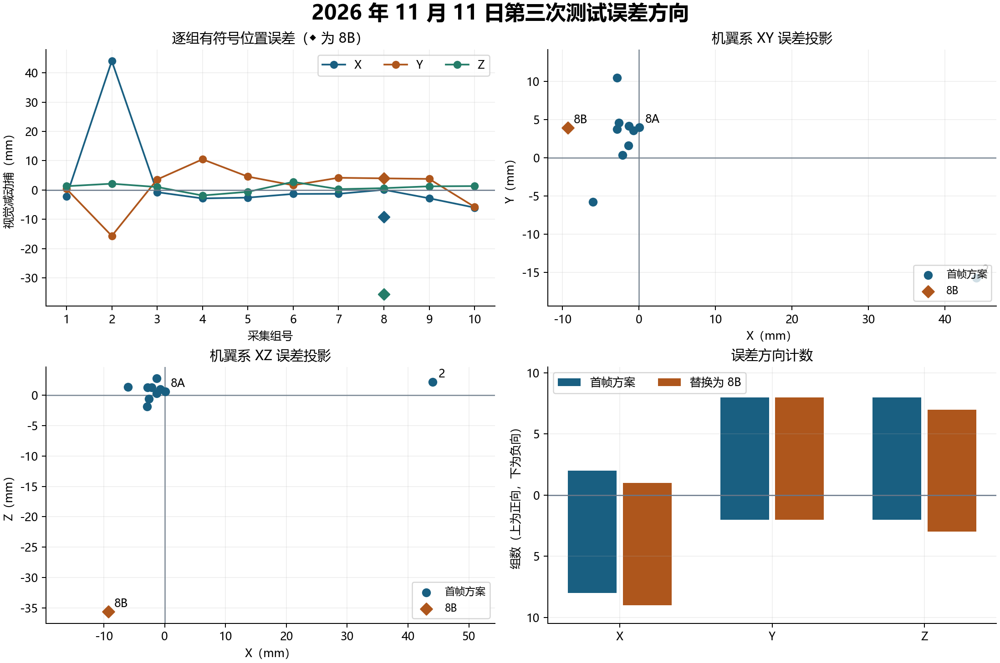
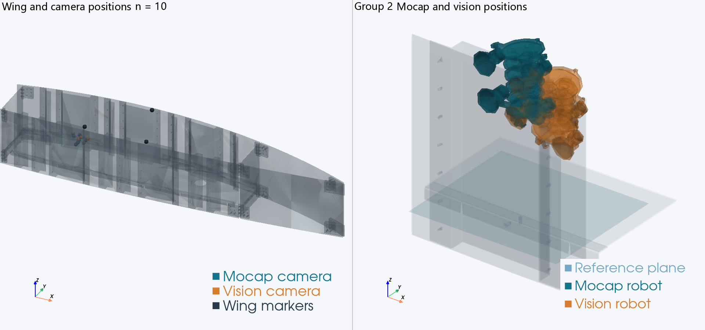

# 2026 年 11 月 11 日第三次定位测试

动捕 MAT 有第 1–10 组。视觉 CSV 有 11 行，其中第 8 组保存了 8A（18:21:57，对焦 368）和 8B（18:22:20，对焦 496）。主统计使用采集顺序中的首帧 8A，另以 8B 替换重算。两个方案各含 10 个独立组号。第 7 组机翼标记用于建立统一坐标基准，每组机器人位姿使用对应组的动捕点。

| 第 8 组取帧 | 平均位置误差（mm） | 位置 RMSE（mm） | 平均姿态误差（°） | 位置分量中位数 XYZ（mm） |
|---|---:|---:|---:|---|
| 8A | 9.472 | 15.827 | 5.518 | (-1.747, +3.688, +1.140) |
| 8B | 12.772 | 19.648 | 6.929 | (-2.373, +3.688, +1.140) |

## 方向一致性

机翼系位置误差按视觉减动捕计算。两种取帧方式下，Y 向误差均有 8/10 组为正，X 向误差分别有 8/10、9/10 组为负。同时满足 −X、+Y 的组数分别是 7/10 和 8/10。两种方案的分量中位数都指向 −X、+Y、+Z，Z 的中位偏移约 1.14 mm。

按单位误差方向计算平均合向量的长度，8A 和 8B 方案分别为 0.612 和 0.526（范围 0–1）。直接按大小求均值则得到 (+2.432, +1.117, +0.830) mm 和 (+1.498, +1.113, -2.798) mm。少数大误差显著拉动均值，导致平均向量与多数样本的方向不同。

主方案扣除本批样本的平均平移后，RMSE 从 15.827 mm 降至 15.577 mm，平均误差却从 9.472 mm 升至 10.062 mm。替换为 8B 后，平均误差也从 12.772 mm 升至 13.642 mm。本批可见方向倾向，单一固定平移对整体误差的解释有限。

把各组位置误差转到其动捕相机坐标系后，主方案的 X 负向为 9/10，Y 负向为 8/10，光轴 Z 负向为 7/10。机翼系相对姿态的旋转向量 Y 分量在 8A 和 8B 方案中分别有 9/10 和 8/10 组为正。旋转向量分量描述绕对应轴的旋转方向。

## 大误差记录

第 2 组的位置误差为 46.814 mm，姿态误差为 24.135°，而在线重投影 RMSE 为 0.223 px。这次各帧用于定位的标签均只有机翼上的第 5 号 AprilTag。

对第 2 组保留的四角点和逐帧内参做平面 PnP 双候选诊断，得到以下结果。角点 RMSE 使用四角点计算，在线 RMSE 还可能包含标签中心。诊断候选未用于主统计。

| 候选 | 四角点重投影 RMSE（px） | 相对动捕位置误差（mm） | 姿态误差（°） |
|---|---:|---:|---:|
| 1 | 0.220 | 49.478 | 25.446 |
| 2 | 0.367 | 6.980 | 1.280 |

第 2 组存在两个能较好解释角点的姿态，重投影残差较小的一支与动捕的差距反而较大。8A 和 8B 对同一组动捕的位置误差分别为 4.028 mm 和 37.035 mm。两帧对应角点相差 46.5–123.9 px，8B 同时使用外推内参。MAT 文件没有逐组时间戳，无法确认哪帧与第 8 组动捕同步。

三路红外在全部记录均显示断开，有效红外平面为 0 组。

## 输出文件

- [11 帧位置和姿态分量](directional_errors.csv)
- [两种第 8 组取帧方案的统计](direction_summary.json)
- [第 2 组平面候选](planar_pose_candidates.csv)
- [误差方向一致性专项分析](方向一致性分析.md)（`python analyze_direction_consistency.py`）
- 在本目录运行 `python analyze_error_directions.py` 可重算。

