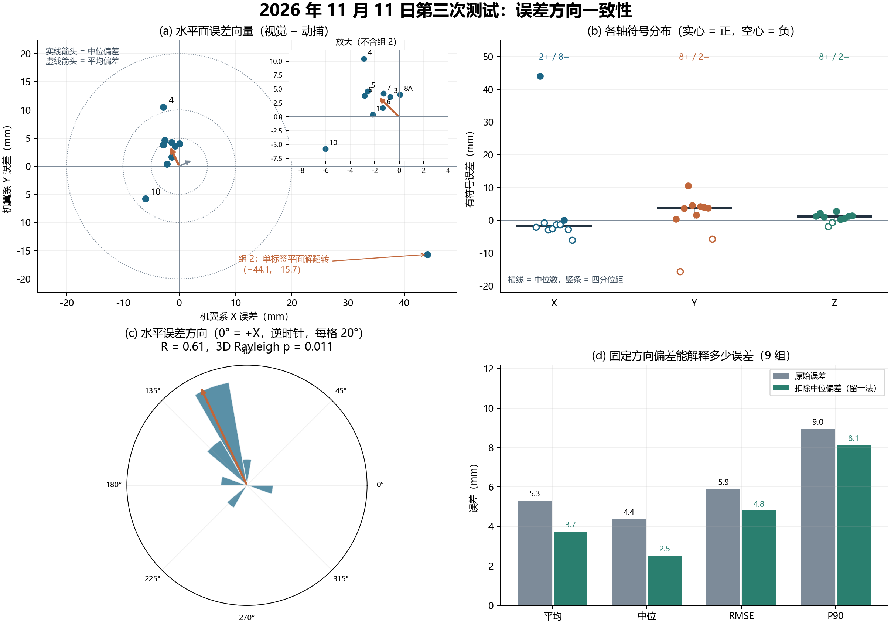

# 第三次测试（2026-11-11）：误差方向一致性

数据为 `26.11.11红外+相机精度测试3`：动捕 MAT 第 1–10 组，视觉 CSV 共 11 行，其中第 8 组保存了 8A（对焦 368）和 8B（对焦 496）两帧，主统计用 8A。误差定义为**视觉估计 − 动捕参考**：位置误差取相机光心之差，姿态误差取相对旋转向量，全部在机翼动捕系（第 7 组三个机翼标记建立）中表达；+Z 指向机翼上方（标签平面在 z = −75 mm），+Y 指向机翼标记 y = 3 mm 到 241 mm 的一侧。

## 结论

**有方向一致性，但要从“方向”这一层看。** 10 个独立组里 X 为负 8/10、Y 为正 8/10、Z 为正 8/10，同时落在 −X/+Y 象限的有 7/10 组；误差方向的合成向量长度 R = 0.61（0 为各向随机，1 为完全同向），三维 Rayleigh 检验 p = 0.0105，水平面内 p = 0.0173——方向分布明显不是各向同性。分量中位偏差 (-1.75, +3.69, +1.14) mm，模长 4.24 mm。

**单轴偏移量的证据弱于方向证据。** 单个轴的符号检验 8/10 只给出 p = 0.11；中位偏差的 bootstrap 95% 区间 X [-2.83, -0.61]、Z [+0.01, +1.73] 不含 0，Y [-2.07, +4.28] 跨 0（重采样里抽到两个负样本就会把中位数拉下去）。剔除选支失败的第 2 组后，9 组的 X [-2.87, -0.74]、Y [+0.39, +4.58] 都不含 0，R 升到 0.76（p = 0.0013）。

**一致的是方向，不是幅度。** 单组合模长 2.54–11.03 mm（第 2 组的 46.8 mm 见后文），用其余组的中位偏差做留一法补偿后，9 组的中位误差从 4.39 mm 降到 2.52 mm（−42%），RMSE 从 5.90 降到 4.80 mm（−19%）。也就是说，典型误差里有约四成可以用一个固定方向抵消，剩下的仍是逐组散布，不能当成刚体平移一次性标定掉。

**方向一致主要来自姿态。** 姿态误差的旋转向量几乎只沿机翼系 Y 轴：Y 分量 9/10 为正（二项 p = 0.0215，中位 +1.21°）。而位置 X 误差与绕 Y 的转角在 9 组（剔除第 2 组）内高度线性相关：r = 0.87，p = 0.0020，斜率 1.20 mm/°，截距 -3.60 mm；相机到 5 号标签中心的距离为 79–125 mm，对应力臂 1.4–2.2 mm/°，量级与实测斜率一致。这条关系与“姿态转了一点、相机光心被力臂带着走”一致；但截距 -3.60 mm 说明 X 上还叠着一个与姿态无关的固定偏移，转角只解释其中随组变化的部分。

## 方向一致性的量化

| 检验 | 结果 | 解释 |
|---|---:|---|
| X 符号（负/正） | 8/2，二项 p = 0.109 | 单轴证据中等，未过 0.05 |
| Y 符号（负/正） | 2/8，二项 p = 0.109 | 同上；Y 是偏移量最大的一轴 |
| Z 符号（负/正） | 2/8，二项 p = 0.109 | 量级小但符号很齐 |
| −X 且 +Y 象限 | 7/10，p = 0.0035 | 象限是看完数据后选的，p 值偏乐观，作参考 |
| 三维 Rayleigh | R = 0.61，p = 0.0105 | 拒绝“方向各向同性” |
| 水平 Rayleigh | R_xy = 0.64，p = 0.0173 | 水平面内聚集更明显 |
| 中位偏差 95% CI（10 组） | X [-2.83, -0.61]，Y [-2.07, +4.28]，Z [+0.01, +1.73] | X、Z 不含 0，Y 跨 0 |
| 中位偏差 95% CI（9 组） | X [-2.87, -0.74]，Y [+0.39, +4.58]，Z [-0.61, +1.34] | 剔除第 2 组后 X、Y 均不含 0 |

用平均向量判断会得到相反印象：均值 (+2.43, +1.12, +0.83) mm，95% CI 为 X [-3.00, +12.06]，Y [-3.59, +4.78]，Z [+0.02, +1.58]，X、Y 的区间都跨 0，只有 Z 不含 0。原因是第 2 组的 +44 mm 把 X 均值拉成正的。**这批数据不能用平均误差描述偏差**，中位数才代表多数样本。

## 逐组数据

| 组 | X | Y | Z | 合模长 | 与中位偏差夹角 | 姿态误差 |
|---|---:|---:|---:|---:|---:|---:|
| 1 | -2.15 | +0.39 | +1.30 | 2.54 | 52° | 1.63° |
| 2 | +44.06 | -15.67 | +2.15 | 46.81 | 132° | 24.13° |
| 3 | -0.74 | +3.59 | +1.02 | 3.81 | 13° | 2.90° |
| 4 | -2.87 | +10.49 | -1.87 | 11.03 | 27° | 9.40° |
| 5 | -2.59 | +4.58 | -0.61 | 5.30 | 23° | 3.53° |
| 6 | -1.34 | +1.62 | +2.78 | 3.48 | 39° | 3.40° |
| 7 | -1.30 | +4.18 | +0.29 | 4.39 | 14° | 0.68° |
| 8A | +0.08 | +3.98 | +0.63 | 4.03 | 27° | 2.84° |
| 9 | -2.83 | +3.78 | +1.26 | 4.89 | 11° | 1.52° |
| 10 | -6.00 | -5.77 | +1.34 | 8.43 | 105° | 5.15° |

10 组误差向量与中位偏差方向的夹角中位数为 27°，7/10 组在 45° 以内；例外是第 1 组 52°、第 10 组 105°、第 2 组 132°。方向确实集中，但同一个方向的模长能从 2.5 mm 变到 11 mm。

## 第 2 组：方向反转是算法选支，不是反例

第 2 组误差 (+44.06, −15.67, +2.15) mm、姿态 24.1°，方向与其余组正好相反，把均值和 RMSE 全部带偏。`分析报告.md` 中的平面 PnP 双候选诊断显示：同一组角点存在两支解，低四角点 RMSE 的那支（0.220 px）与动捕差 49.5 mm、姿态差 25.4°，另一支（0.367 px）只差 6.98 mm、姿态差 1.28°。在线重投影 RMSE 只有 0.223 px，残差小并不代表位姿对。这类样本必须单独判支，不能混进方向统计当作噪声。

剔除第 2 组后的复核（9 组）：X 负 8/9、Y 正 8/9、−X/+Y 象限 7/9，方向合成 R 从 0.61 升到 0.76，3D Rayleigh p = 0.0013；中位偏差 (-2.15, +3.78, +1.02) mm，中位误差 4.39 mm。

## 补偿效果：能减四成，不能全减

| 方案 | 平均误差 | 中位误差 | RMSE | P90 |
|---|---:|---:|---:|---:|
| 原始（9 组） | 5.32 | 4.39 | 5.90 | 8.95 |
| 扣除中位偏差（9 组） | 3.75 | 2.52 | 4.80 | 8.13 |
| 原始（全部 10 组） | 9.47 | 4.64 | 15.83 | 14.61 |
| 扣除中位偏差（10 组） | 8.41 | 2.68 | 16.51 | 14.58 |

9 组时补偿让中位数和 RMSE 都明显下降；把第 2 组放回去后 RMSE 反而从 15.83 升到 16.51 mm——因为选支失败那一组的误差被补偿推得更远。这正说明固定方向偏差只能解释“多数正常样本”，对少数结构性失败无效。

## 为什么这批数据会这么一致

1. 10 组全部只用机翼上的 5 号标签求解（`known_tag_ids` 恒为 `[5]`），没有多标签冗余。
2. 机器人只在一个约 8 cm × 3 cm × 7 cm 的小范围内重复取位（相机光心 X 0.281–0.357 m、Y 0.056–0.081 m、Z −0.026–0.046 m），视角变化很小。
3. 同一标签、近似同一视角下，内参、安装外参、标签位姿的任何系统误差都投影成几乎相同的世界系向量，于是“方向一致、幅度抖动”；单标签平面求解的倾斜/深度弱约束又让转角和位移耦合（见上文的 1.2 mm/° 关系）。

**因此这批数据无法区分“固定视角下的系统偏差”和“与视角相关的模型误差”。** 要定位误差来源（内参、外参、标签位姿还是深度弱约束），必须换视角重复采集，例如改变距离、俯仰和偏航各若干组，再看误差向量是否随视角旋转。

## 敏感性

若把第 8 组改用 8B 帧：X 负 9/10、Y 正 8/10、−X/+Y 象限 8/10、R = 0.53，方向结论不变，只是 8B 的 −35.6 mm Z 误差让 Z 的离散度变大。8B 与 8A 的角点相差 46–124 px，且动捕 MAT 没有逐组时间戳，无法确认 8B 对应同一时刻，故不计入主统计。

## 红外

三路红外在全部 11 条记录中都是 `DISCONNECTED`，`plane_valid` 全为 False，本次没有任何红外距离或法向数据，方向一致性只覆盖视觉。

## 输出

- [方向一致性图](direction_consistency.png)
- [检验结果与逐组数据](direction_consistency.json)
- [逐组夹角](direction_angles.csv)
- 重算：先 `python analyze_error_directions.py`，再 `python analyze_direction_consistency.py`

