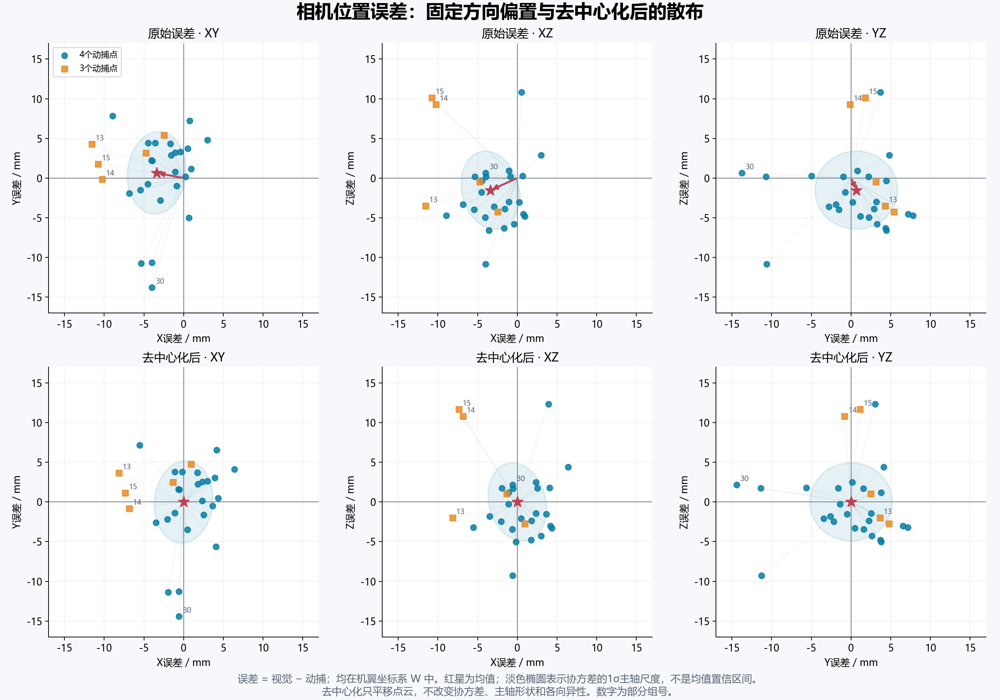
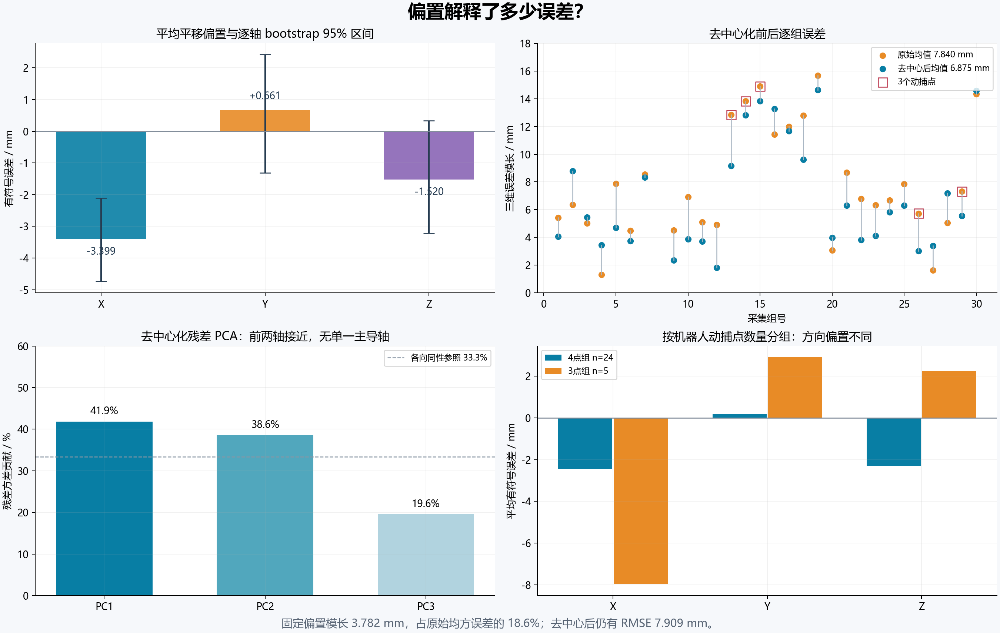
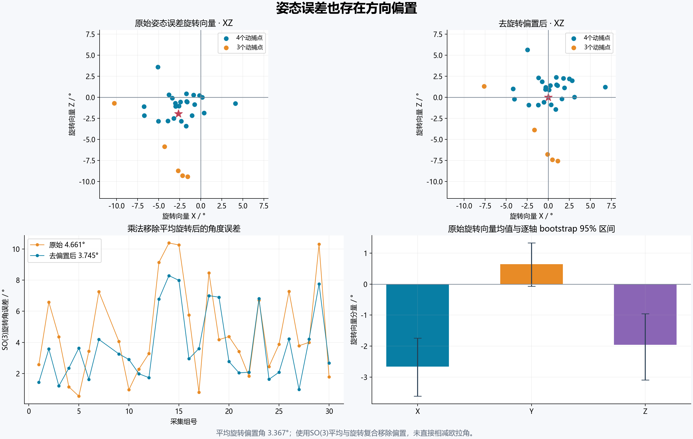

# 相机误差的方向一致性与去中心化分析

实验数据日期：2026-11-01。基于前次动捕配准所得29组有效视觉记录；第8组PnP失败排除，所有其余组均保留。

## 结论

位置误差存在明确的 −X 方向偏置，但不能用一个固定方向的平移偏差解释全部误差。去中心化后，误差在Y、Z方向的散布更大，且前两个主成分很接近，没有单一主导方向。姿态误差也有以 −X、−Z 为主的旋转偏置。

## 1. 位置误差的方向偏置

定义 e_i=t_vision,i−t_mocap,i，均在机翼坐标系W中，单位mm。平均偏置 b=(1/n)Σe_i，去中心化残差 r_i=e_i−b。这里减去的是**三维有符号误差向量的均值**，不是从每组误差模长中减去7.840 mm。

- 平均误差向量 b=(-3.399, +0.661, -1.520) mm，模长 3.782 mm。
- 平均向量的单位方向为 (-0.899, +0.175, -0.402)；主要朝 −X，同时有较弱 −Z 分量。
- X误差为负的记录有 23/29 组（79.3%）；Y为正19组，Z为负19组。
- 单位误差方向的平均合向量长度为 0.509（1为完全同向；0为方向抵消）。这是描述统计，没有把它当作独立的显著性检验。

| 分量 | 平均偏置 / mm | bootstrap逐轴95%区间 / mm | 去中心化后样本标准差 / mm |
|---|---:|---:|---:|
| X | -3.399 | [-4.741, -2.112] | 3.687 |
| Y | +0.661 | [-1.311, +2.419] | 5.194 |
| Z | -1.520 | [-3.217, +0.329] | 4.922 |

X轴正负号的双侧二项检验 p=0.00232，即便对XYZ三轴作Bonferroni校正约为 0.00695。三维均值的Hotelling T²检验 p=0.000152。这些推断依赖样本独立等假设；本实验组序和姿态可能相关，所以应以本批数据的方向偏置证据解释，而不是宣称普适误差模型。

## 2. 去中心化后误差降低多少

| 指标 | 原始 | 去中心化后 |
|---|---:|---:|
| 三维误差模长均值 / mm | 7.840 | 6.875 |
| 三维RMSE / mm | 8.767 | 7.909 |
| 平均误差向量模长 / mm | 3.782 | 0（按定义） |

平均误差模长下降 12.3%，RMSE下降 9.8%。平方误差有严格分解：MSE_original=||b||²+MSE_centered；固定偏置只占原始均方误差的 18.6%，剩余 81.4% 不会被一个统一平移量消除。

上述是使用同批数据估计均值后的描述性结果。留一法中，每组只用其余28组估计偏置，平均误差为 7.121 mm，RMSE为 8.192 mm。这也不是独立实验验证，不应把同批去中心结果直接视为可部署标定精度。

若要按这批数据做固定W系平移补偿，表达式为 t_corrected=t_vision−b，即给视觉位置加 (+3.399, -0.661, +1.520) mm。实际使用前应在独立数据上验证。

## 3. 去中心化后仍有方向性吗

去中心化强制平均误差为零，因此不能仅凭均值为零断言误差没有方向结构。减均值不会改变协方差矩阵、逐轴标准差或PCA主轴形状，只会把点云中心搬到原点。

去中心化后的标准差 σ_X、σ_Y、σ_Z = (+3.687, +5.194, +4.922) mm。Y、Z明显比X更分散，Y和Z合计占坐标轴总方差约 79.0%。

| 主轴 | 方差贡献 | 该轴样本标准差 / mm |
|---|---:|---:|
| PC1 | 41.85% | 5.207 |
| PC2 | 38.58% | 4.999 |
| PC3 | 19.57% | 3.561 |

最长/最短主轴的标准差比为 1.462。PC1与PC2特征值之比仅 1.085，两轴接近，单个主轴的精确朝向容易随抽样变化，不适合宣称存在稳定的一条误差方向。

PC1单位向量为 (+0.114, +0.990, -0.084)（约沿Y）；PC2为 (-0.243, +0.109, +0.964)（约沿Z）。主轴正负号没有物理意义，表示同一条轴。

## 4. 三点动捕组是否影响结论

| 动捕机器人标记点 | 组数 | 平均误差向量 / mm | 原始平均模长 / mm | 各子组分别去中心后 / mm |
|---|---:|---|---:|---:|
| 4点 | 24 | (-2.447, +0.195, -2.303) | 7.198 | 6.321 |
| 3点 | 5 | (-7.970, +2.901, +2.237) | 10.921 | 7.288 |

三点组为13、14、15、26、29，五组X误差全部为负。它们的平均偏置明显不同于四点组；但剔开三点组单看四点组，仍有18/24组X误差为负，说明 −X 偏向不完全由缺失点造成。分组偏置也提示不能默认所有姿态与动捕质量都适用同一个校正量。三点组仅5个样本，不宜据此建立单独标定模型。

## 5. 世界系固定偏置还是相机系固定偏置

另用动捕相机姿态计算 e_C=R_gtᵀe_W，将每组误差分解到真实相机局部轴后，再求相机系统一均值。这与先在W系去中心化再旋转是两个不同的模型，不能混为一谈。

相机系平均误差为 (-1.921, -0.401, +1.228) mm，模长 2.315 mm。固定C系偏置只解释原始均方误差的 7.0%，去中心后平均误差 7.241 mm、RMSE 8.456 mm。W系固定偏置解释度为 18.6%，在本批数据中更高；这提供坐标系层面的诊断线索，但不能唯一确定误差来自世界系标定、安装误差或视觉算法。

## 6. 姿态误差去中心化

姿态误差使用 D_i=R_vision,i R_gt,iᵀ。由于旋转不满足普通向量加法，正式去偏置采用SciPy的SO(3)弦均值B，令 D_centered,i=D_i Bᵀ，随后计算其旋转角；没有直接相减欧拉角。对应的视觉姿态补偿可写为 R_corrected=BᵀR_vision，其误差角与上述残差相同。

- 平均旋转偏置B的轴角向量（W系）为 (-2.664, +0.639, -1.958)°，偏置角 3.367°。向量分量不是三个欧拉角。
- 原始误差旋转向量的X分量26/29为负，Z分量23/29为负，存在较明显的 −X、−Z 旋转取向。
- 平均姿态误差从 4.661° 降到 3.745°；姿态RMSE从 5.508° 降到 4.358°。
- 旋转向量减去普通算术均值的结果也保存在JSON中作为小角度诊断；CSV和上述正式角度结果使用SO(3)乘法去偏置。SO(3)去偏置不要求其对数向量算术均值恰好为零。

## 7. 限制、文件与复现

- 继续沿用前次动捕对应关系、去重和前向约束。机翼标记配准残差约4.945 mm，且视觉与动捕采集非同步；方向偏置可能同时包含参考几何、安装和组间运动等因素，不能直接归因为相机自身。
- 未使用三维误差模长平均值对位置向量作平移。未删除原分析保留的任何有效视觉样本；第17组的红外异常不构成本次视觉剔除依据。
- Bootstrap按29组有放回抽样，20000次，种子20261101，区间为逐轴百分位区间；没有同时置信保证，也不包含动捕参考坐标的系统性不确定度。
- 所有去中心化、PCA和区间均为这批实验数据的统计描述；残差不能直接叫作纯随机噪声，可能仍包含随姿态变化的系统误差。
- [camera_error_cloud_3d.html](camera_error_cloud_3d.html)：离线双视窗三维误差点云，坐标表示误差分量，而不是机器人在机翼中的位置。
- centered_per_group.csv：逐组W系去中心位置残差、C系误差、留一法误差、SO(3)去偏置姿态结果。原始输入文件未修改。
- centering_summary.json：均值、协方差、PCA、分组与置信区间完整数值；validation_checks.json记录零均值、协方差不变、均方误差分解等核验。
- 复现：在原项目目录运行 python analyze_camera_centering.py。
