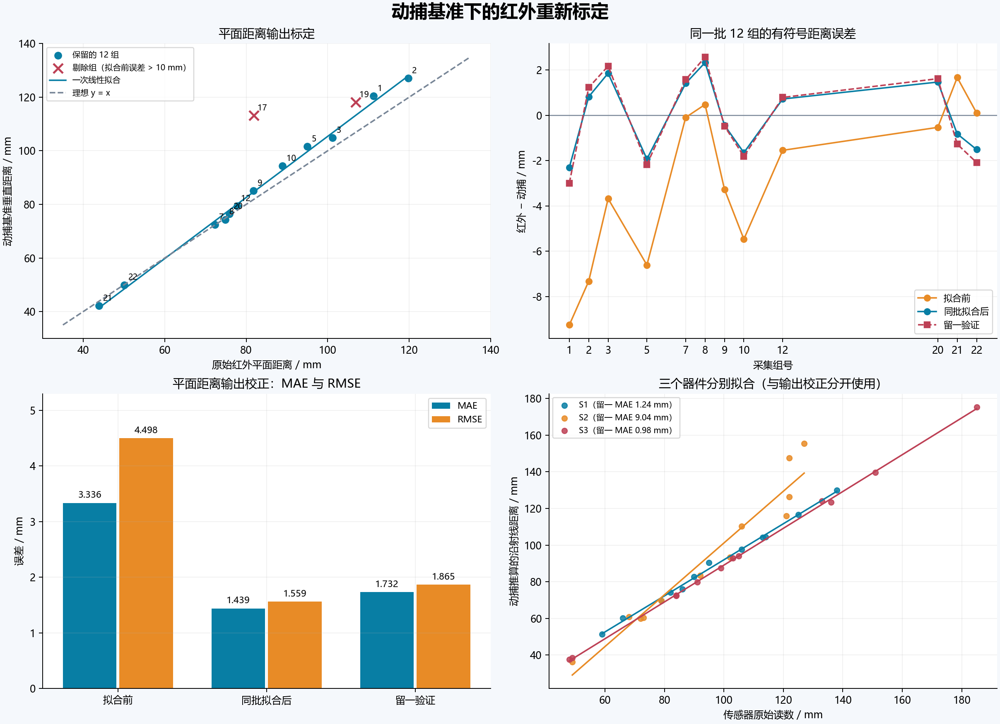
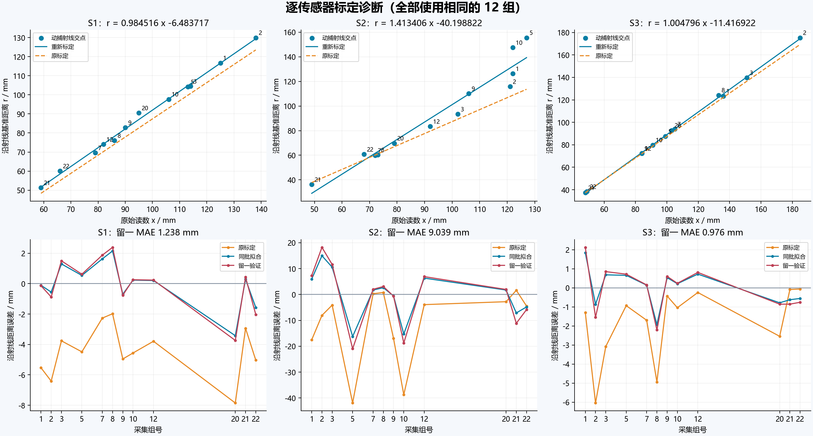

# 以动捕为基准的红外重新标定

## 结果与使用建议

按**拟合前**红外平面距离绝对误差大于 10 mm 剔除整组。原有 14 组有效平面，剔除第 17、19 组，保留 12 组：1、2、3、5、7、8、9、10、12、20、21、22。其余无效平面组不补值、不纳入标定。第 8 组虽然视觉失败，红外与动捕有效，仍保留。

最终平面距离的一次拟合公式为：

```text
d_corrected_mm = 1.140098384 * d_original_mm -8.629503498
```

公式输入为现有三传感器融合后输出的 `plane_distance_mm`。校正一次即可。下表始终比较同一批保留组，以区分异常组剔除与拟合各自带来的变化。

| 平面距离结果 | 组数 | MAE / mm | RMSE / mm | 有符号偏差 / mm | 最大绝对误差 / mm |
|---|---:|---:|---:|---:|---:|
| 原始全部有效组（仅作背景） | 14 | 5.904 | 9.825 | -5.581 | 31.316 |
| 剔除后、拟合前 | 12 | 3.336 | 4.498 | -2.958 | 9.257 |
| 平面距离线性校正（同批拟合） | 12 | 1.439 | 1.559 | +0.000 | 2.335 |
| 平面距离线性校正（留一验证） | 12 | 1.732 | 1.865 | -0.068 | 2.990 |

保留组同批拟合的距离 MAE 降低 56.9%。每次留一验证使用另外 11 组重新拟合，再预测被留出的组。筛选名单在拟合前固定，未按拟合后残差再次删组。留一结果针对本次筛选后的样本，仍需独立采集验证。

距离输出校正保持原法向，保留组法向平均误差仍为 **5.780°**。若需要同步校正法向，应检查下文的逐传感器结果。

本批公式输入覆盖 43.816～119.750 mm，对应动捕垂直距离 42.143～127.073 mm。超出此范围的表现尚未验证。



## 剔除记录

| 组号 | 原始红外距离 / mm | 动捕距离 / mm | 绝对误差 / mm |
|---|---:|---:|---:|
| 17 | 81.848 | 113.164 | 31.316 |
| 19 | 106.860 | 118.174 | 11.314 |

阈值针对融合平面的垂直距离误差，不针对单个传感器沿射线误差。等于阈值的组保留。

## 三个传感器分别重新拟合

分别拟合 `r_new_mm = a * raw_mm + b`，输入为 `s1_raw_mm`、`s2_raw_mm`、`s3_raw_mm`。新公式替换原来的器件距离标定，随后沿现有安装射线重建三个命中点，并重新求平面。此流程与上面的最终距离输出校正是两种替代方案，不能叠加使用。

| 传感器 | a | b / mm | 原始读数范围 / mm | 原标定 MAE / mm | 同批拟合 MAE / mm | 留一 MAE / mm |
|---|---:|---:|---|---:|---:|---:|
| S1 | 0.984515881 | -6.483717087 | 59～138 | 4.466 | 1.059 | 1.238 |
| S2 | 1.413405989 | -40.198822006 | 49～127 | 11.765 | 7.327 | 9.039 |
| S3 | 1.004795516 | -11.416922250 | 48～185 | 1.869 | 0.795 | 0.976 |

以上为沿传感器射线距离的误差，不能直接与垂直平面距离误差混用。

| 三点重建后的结果 | 平面距离 MAE / mm | 平面距离 RMSE / mm | 法向平均误差 / ° |
|---|---:|---:|---:|
| 原标定 | 3.336 | 4.498 | 5.780 |
| 逐传感器线性重标定（同批） | 3.097 | 4.182 | 4.839 |
| 逐传感器线性重标定（留一） | 3.776 | 5.000 | 5.990 |

S1、S3 的沿射线距离得到较好校正。S2 在第 1、10 组的原始读数均为 122 mm，动捕推算的射线距离却分别为约 126.251、147.501 mm。仅靠读数的一次函数无法同时拟合这两点。第 5、10 组的 S2 原标定沿射线误差也接近 40 mm，但整组三点融合距离误差未超过 10 mm，因此按本次规则仍保留。

逐传感器重标定后的平面距离留一误差高于原标定，当前数据不支持把这套三器件参数作为已验证的整体改进。若目标是改善现有距离输出，优先使用上面的平面距离线性校正；若目标包括法向精度，需复核 S2 的命中表面、安装射线、组间静止状态及动捕基准，再采集数据验证。



## 计算方法与模型选择

1. 直接从 `markerPos_test_1.mat` 重建动捕机器人位姿，沿用已有的标记点枚举与正向命中约束，不使用视觉位姿参与拟合。机器人三点组枚举全部 4 选 3 子集及排列。
2. 基准面为 `z_W = -75 mm`。`T_W_R` 的旋转和平移记为 `R,t`，则机器人系平面 `n_R · p_R + c_R = 0` 中，`n_R = Rᵀ[0,0,1]`，`c_R = t_z + 75`，真实垂直距离为 `abs(c_R)`。
3. 从记录的 `s*_calibrated_mm` 与 `s*_point_*_m` 恢复固定射线 `p_R = o_R + r*u_R`。只用保留组恢复既有安装关系，再用其他可用点验证。没有重新估计安装外参。动捕射线距离为 `r_gt = -(n_R·o_R + c_R)/(n_R·u_R)`。
4. 三器件分别以原始读数拟合真实射线距离。重建三个命中点后，叉积求单位法向，再计算原点到平面的垂直距离与 `acos(abs(n_fit·n_gt))` 法向误差。
5. 所有拟合均为普通最小二乘。平面距离输出比较偏置、一次和二次模型；采用一次模型，因其留一表现优于偏置和二次模型。逐传感器统一采用一次模型，避免小样本高阶拟合。

| 平面输出模型 | 同批 MAE / mm | 同批 RMSE / mm | 留一 MAE / mm | 留一 RMSE / mm |
|---|---:|---:|---:|---:|
| 仅偏置 | 2.976 | 3.389 | 3.246 | 3.697 |
| 一次线性（采用） | 1.439 | 1.559 | 1.732 | 1.865 |
| 二次 | 1.335 | 1.493 | 1.824 | 2.123 |

原有机翼名义标记几何与动捕边长存在约 1.5～10.4 mm 的不一致，机翼配准平均点残差约 4.945 mm。这里的拟合吸收了当前基准中的系统误差，结果依赖该安装、基准面及按组序静态配对条件。

## 逐组平面距离结果

| 组号 | 动捕 / mm | 原始红外 / mm | 校正后 / mm | 校正有符号误差 / mm | 留一有符号误差 / mm |
|---|---:|---:|---:|---:|---:|
| 1 | 120.498 | 111.242 | 118.197 | -2.301 | -2.990 |
| 2 | 127.073 | 119.750 | 127.898 | +0.824 | +1.232 |
| 3 | 104.827 | 101.148 | 106.690 | +1.862 | +2.178 |
| 5 | 101.629 | 95.019 | 99.701 | -1.928 | -2.168 |
| 7 | 72.430 | 72.342 | 73.848 | +1.417 | +1.580 |
| 8 | 74.347 | 74.828 | 76.681 | +2.335 | +2.578 |
| 9 | 85.072 | 81.805 | 84.636 | -0.435 | -0.475 |
| 10 | 94.355 | 88.886 | 92.709 | -1.645 | -1.809 |
| 12 | 79.321 | 77.778 | 80.046 | +0.724 | +0.794 |
| 20 | 76.408 | 75.880 | 77.881 | +1.473 | +1.622 |
| 21 | 42.143 | 43.816 | 41.326 | -0.817 | -1.270 |
| 22 | 49.950 | 50.059 | 48.443 | -1.508 | -2.082 |

## 输出与复现

- `calibration_coefficients.json`：距离输出校正与三个器件的完整参数、射线几何和适用范围。
- `per_group_calibration.csv`：全部 30 组及筛选原因，保留组的两种校正与留一结果。
- `per_sensor_calibration.csv`：保留组的逐器件原始读数、动捕射线距离及误差。
- `summary_metrics.csv`、`summary.json`：数值统计。
- `validation_checks.json`：原始平面复原、射线交点、阈值筛选、留一排除检查。
- `leave_one_out_folds.json`：逐器件每折的训练组号和系数。
- `input_manifest.json`：原始数据与复现脚本的 SHA-256。

```powershell
python calibrate_infrared.py
```

默认仅生成 `results/infrared_calibration/`，原始采集文件与之前的分析结果保持不变。
CSV 以 UTF-8 BOM 保存。
