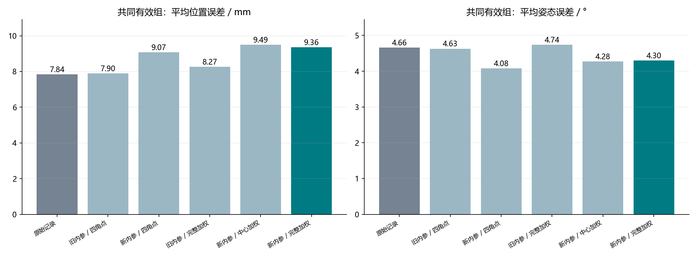
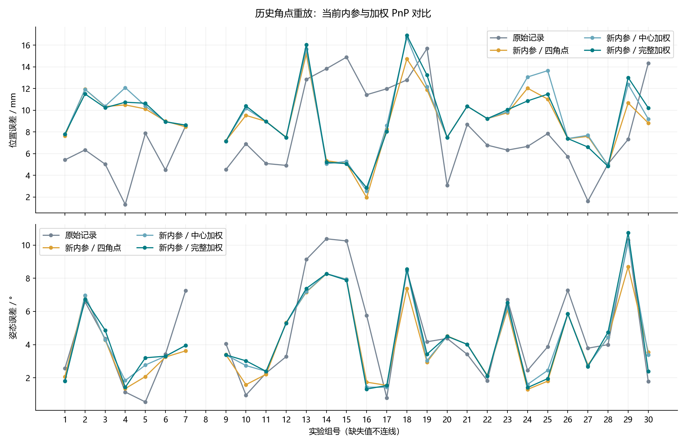
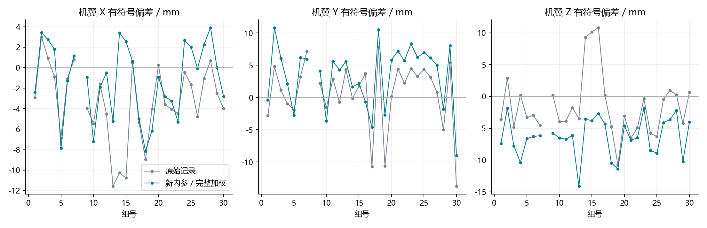

# 历史相机数据：新内参与加权 PnP 重算分析

本报告是基于历史 CSV 亚像素角点的离线重放。快照已有绘制标注，无法重新检测；中心点由四边形恢复，未将其表述为重新检测得到的独立测量。

## 结果与比较口径

原始记录有效 29 组；当前完整算法重算有效 29 组。各方法共同有效组共 29 组，用相同组号比较，不按误差大小删组。

共同组中，平均位置误差 7.840 → 9.359 mm（变化 +19.4%）；平均姿态误差 4.661 → 4.300°（变化 -7.7%）。正变化表示误差增加。

| 方法 | n | 位置均值 mm | 位置 RMSE mm | 位置 P95 mm | 姿态均值 ° | 姿态 RMSE ° |
|---|---:|---:|---:|---:|---:|---:|
| 原始记录 | 29 | 7.840 | 8.767 | 14.670 | 4.661 | 5.508 |
| 旧内参 / 四角点 | 29 | 7.895 | 8.806 | 14.670 | 4.630 | 5.496 |
| 新内参 / 四角点 | 29 | 9.067 | 9.481 | 13.654 | 4.080 | 4.671 |
| 旧内参 / 完整加权 | 29 | 8.266 | 9.360 | 16.374 | 4.736 | 5.783 |
| 新内参 / 中心加权 | 29 | 9.491 | 9.992 | 14.837 | 4.277 | 4.891 |
| 新内参 / 完整加权 | 29 | 9.359 | 9.854 | 14.924 | 4.300 | 4.962 |

### 如何解释变化

- **本批数据不支持“新内参加完整加权全面更准”的结论。** 相对原始记录，位置误差在 7 组降低、22 组增加；姿态误差在 14 组降低、15 组增加。
- 在相同新内参下，四角点版本为 9.067 mm / 4.080°；加入中心加权后为 9.491 mm / 4.277°；再加入画面中心偏好后为 9.359 mm / 4.300°。画面中心偏好对位置有小幅补偿，但完整加权仍不及该内参下的四角点版本。
- 完整算法新结果的 Z 平均偏差为 -6.330 mm，而原始为 -1.520 mm；Y 平均偏差为 +3.411 mm，原始为 +0.661 mm。这说明位置变化包含系统偏差，而不只是少数异常组。新旧焦距、主点和畸变均变化，不能仅凭这些误差分量判定某一个参数是原因。
- 新完整算法位置最差为第 18 组 16.905 mm，姿态最差为第 29 组 10.743°；第 8 组所有重放方法均失败，不补值。
- 建议先用未标注原图保留检测器原始中心，再在固定镜头和独立动捕验证集上比较四角点与中心加权。没有在本次实验上搜索或调整权重，也没有修改在线配置以迎合误差结果。

红外数据的 37 个测量/平面字段逐项保持原值，误差统计仍为原报告的 14 个有效组：距离绝对误差均值 5.904 mm、法向夹角均值 7.847°。相机位姿重算不改变该独立红外评价。





## 输入快照的限制

对全部 30 张标注快照重新运行当前 AprilTag 检测器，仅 0 张检出已知标签。快照已有绿色框、文字和坐标轴，覆盖码字和边缘。因此主结果采用原 CSV 中保存的亚像素角点重放 PnP，不将对标注图的检测失败误当成原始相机检测能力。
每个标签的二维中心由记录四边形的两条对角线交点恢复，相当于平面单应模型下的中心；没有用四角均值。原 CSV 未保存检测器中心，恢复中心与当时检测器的浮点中心不能逐点核验，也不能完全模拟镜头畸变下的独立中心测量。新算法直接复用当前 positioning_core.VisionEstimator.process，只替换检测器返回值；输入画面已旋转 180°，重放时不再旋转。这属于历史角点离线重放，不是未标注原图上的端到端重新检测实验。

## 方法与可复现性

- 旧 K 来自 charuco_calib.json；新 K 来自当前配置指向的 camera_intrinsics_refined.json。标签布局和尺寸采用当前配置。
- 四角点版本复现迭代/多标签 RANSAC + OpenCV LM；完整算法为 RANSAC 初筛、中心准入和带阻尼加权优化，配置中心权重 4、画面中心 boost 3。中心加权版本只关闭画面中心 boost。
- 每组、每种重放方法都使用相同固定 RANSAC 随机种子 20261101+组号。不使用动捕真值调参、挑内点或做对齐。
- 原始记录与旧内参重放存在求解随机状态、软件版本等差别，不能把重放旧算法与原始记录之间的变化归因于新内参。用旧/新 K 四角点对比观察内参作用，用新 K 四角点/中心加权/完整加权观察算法作用。
- 动捕基准从原 MAT 重新枚举机翼对应关系及机器人所有 4 点排列或 4 选 3 子集与排列，保留原前向约束。重算基准与原 poses.json 最大元素差低于 1e-8。
- 位置误差为机翼系相机位置三维欧氏距离（mm），姿态为相对旋转 SO(3) 角度（°）。红外记录及基准保持原样，不重新标定红外。
- 原标定文件没有旋转元数据；旧 K 的方向仅按历史定位使用方式处理，不事后调整旧主点或畸变。新标定采集于 11 月 6 日，实验采集于 11 月 1 日，期间镜头状态是否一致无法从文件确定。

## 偏差及适用范围

原始记录共同组位置有符号偏差 XYZ：[-3.399, 0.661, -1.52] mm；新完整算法：[-1.214, 3.411, -6.33] mm。
仅作同批数据的去均值诊断，新完整算法去偏差后位置误差均值为 5.925 mm；不将该结果当作独立验证精度或修改在线定位偏置。



原报告中机翼名义标记边长与动捕边长不一致（最大平均差约 10.4 mm），机翼配准 RMS 约 4.945 mm；视觉与动捕按组配对，采集相隔约 60–250 秒。这些基准几何及同步限制仍存在，误差不能全部归因于 PnP。
当前标签布局没有随原实验归档，重放使用当前布局；不能仅由现存文件证明其与采集当日完全一致。应结合逐组内点、标签权重及角点残差排查异常，不能用拟合误差较低直接替代动捕精度检验。

## 文件

- per_group_errors.csv：所有方法、所有组的误差、状态、快照及权重。
- paired_comparison.csv：原始记录与当前完整算法的同组变化，负数表示改善。
- summary_metrics.csv / summary.json：全有效集及共同有效集统计，含有效组列表。
- recomputed_positioning_records.csv：使用当前完整算法替换视觉位姿字段的记录，原红外和采集时间保留；不是新采集数据。
- replay_diagnostics.json：重放中心、角点、位姿、权重、内点；snapshot_detection.csv：标注图重新检测诊断。
- replayed_snapshots/：叠加当前计算标注的存档快照，原图旧标注仍然保留。
- validation_checks.json / input_manifest.json：基准与旧指标复算、唯一配对、输入 SHA-256。

复现命令（项目根目录，输出目录须为空）：

```powershell
python replay_experiment.py --output "26.11.1红外+相机精度测试/results/pnp_replay_20261106"
```
