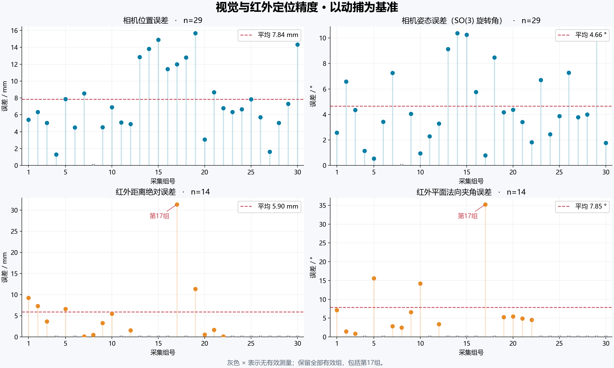
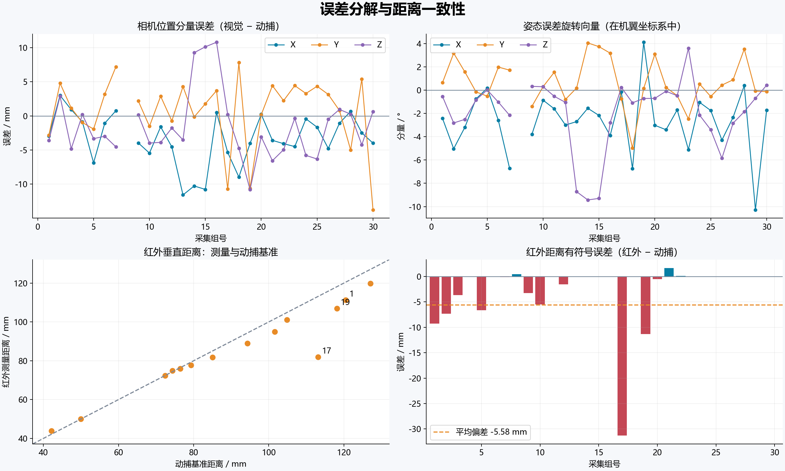
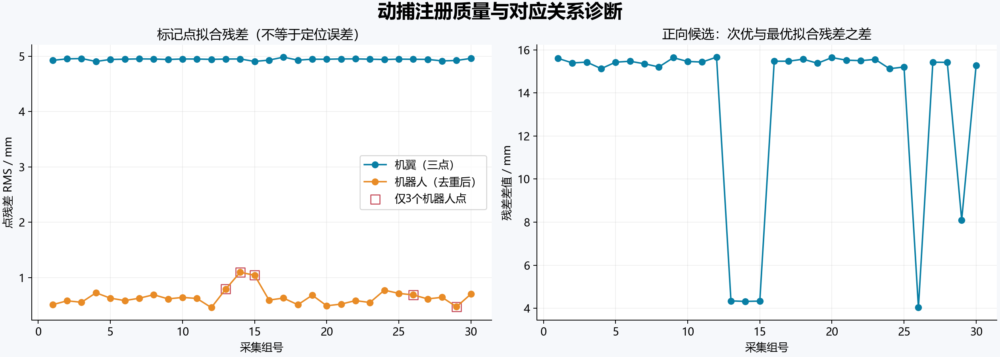
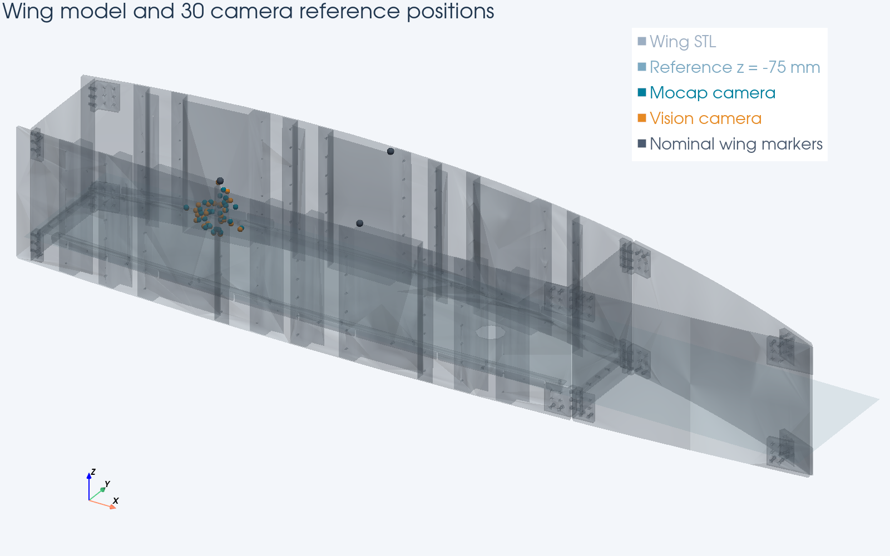
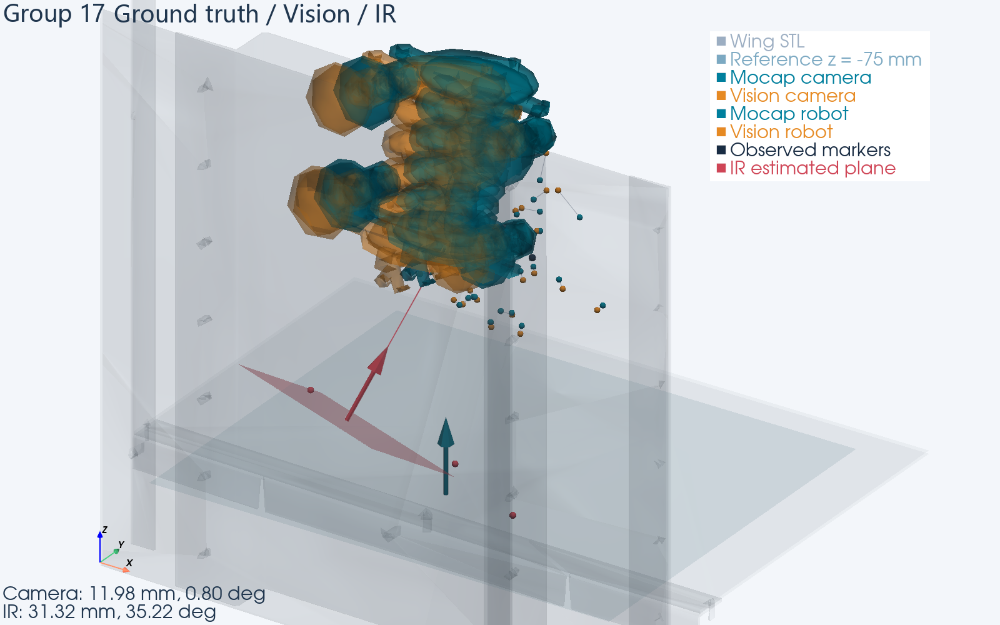

# 单目 AprilTag 与红外定位精度分析

实验日期：2026-11-01。按 README 给出的几何参数与用户确认的组序对应关系计算；没有用视觉结果校准或挑选动捕姿态。

## 结果

| 指标 | 有效组数 | 平均误差 | RMSE | 中位数 | P95 | 最大值 |
|---|---:|---:|---:|---:|---:|---:|
| 相机位置（三维欧氏距离） | 29 | 7.840 mm | 8.767 mm | 6.782 mm | 14.670 mm | 15.685 mm |
| 相机姿态（SO(3) 旋转角） | 29 | 4.661 ° | 5.508 ° | 3.999 ° | 10.280 ° | 10.379 ° |
| 红外距离绝对误差 | 14 | 5.904 mm | 9.825 mm | 3.473 mm | 18.315 mm | 31.316 mm |
| 红外平面法向夹角误差 | 14 | 7.847 ° | 11.679 ° | 5.079 ° | 22.465 ° | 35.222 ° |

相机位置的平均有符号偏差（视觉 − 动捕，机翼 XYZ）为 (-3.399, 0.661, -1.520) mm。
红外距离的平均有符号偏差为 -5.581 mm；负号表示距离测短。

以上平均值均为逐组误差的算术平均。位置平均误差是三维误差模长的均值，不是平均偏差向量的模长；姿态使用相对旋转角，不直接相减欧拉角。P95 使用 NumPy 默认线性插值。



## 配准、单位与误差定义

1. MAT 中实际有 30 个非空组，位于第 1～30 行第 1 列，其余单元为空。MAT 坐标以 m 记录，统一乘 1000 变成 mm；README 标记坐标、STL 和基准平面均按 mm 使用。CSV 的变换矩阵平移也统一转为 mm。
2. 用户已确认：按组序对应 group_id 1～30，视觉世界系 W 即机翼模型系。前三个动捕点枚举 3! 种对应，用只允许 det(R)=+1 的 Kabsch 刚体拟合求 T_M_W；每组分别求解，再取逆得到 T_W_M。没有缩放、反射或用视觉结果做二次对齐。
3. 机器人点先去除完全重复的记录。4 个唯一点枚举 4!=24 种对应；3 个唯一点明确枚举全部 C(4,3)=4 个子集，每个子集再枚举 3!=6 种对应，总计 24 个候选。每组全部候选及其残差均保存在 robot_correspondence_candidates.csv。
4. 机器人标记点接近共面且近似左右对称，残差最小的无约束解常将机器人翻转约 180°。已记录的红外命中点全部位于 +z_R，README 指出测量平面在机器人前方，因此添加物理约束：从机器人原点沿 +z_R 发出的射线必须在正向与 z_W=-75 相交，即 s=(-75-t_z)/R_zz > 0。在满足此条件的候选中选残差最小者。这一步只用标记点、已知平面及传感器朝向，未引用视觉姿态。若实验中基准面并非位于 +z_R 一侧，应修改此约束后重算。
5. T_A_B 表示把 B 系坐标变换到 A 系。T_W_R=T_W_M·T_M_R，T_W_C=T_W_R·T_R_C；相机偏移为 (0,-29.5,4) mm，姿态与机器人相同。
6. 相机位置误差 e_p=||t_W_C(vision)-t_W_C(mocap)||₂。姿态误差 e_R=acos(clip((tr(R_vision·R_gtᵀ)-1)/2,-1,1))，以度表示；代码用 SciPy 旋转角实现以提高数值稳定性。
7. 红外基准是无限平面 z_W=-75 mm。原点至平面真实垂直距离 d_gt=|t_W_R,z+75|。真实法向在机器人系中为 n_gt,R=R_W_Rᵀ·(0,0,1)。距离误差为 |d_IR-d_gt|；角度误差为 acos(|n_IR·n_gt,R|)，归一化法向后计算，故平面法向的正负号不影响结果。这里统计的是三传感器拟合平面的垂直距离，不是单个器件的沿射线量程。

## 数据质量与适用范围

- 第 8 组视觉状态为 PnP failed：不计入视觉误差，仍参与有效红外统计。
- 红外有效组共 14 组：1、2、3、5、7、8、9、10、12、17、19、20、21、22；其余 16 组不补值，不计入红外统计。
- 第 15 组有 8 个非空标记记录：最后两个点分别重复前面机器人点；第 26 组最后一个点重复。删除重复后，只有 3 个机器人点的组为 13、14、15、26、29；均遍历全部缺失点可能性。
- 无约束最小残差落入翻转分支的组有 28 组；加入前向约束后，最小次优残差差值为 4.030 mm。该差值只用于诊断，不是概率或置信区间。

### 机翼标记几何存在系统性不一致

| 边 | README 名义边长 / mm | 动捕平均边长 / mm | 平均差值 / mm |
|---|---:|---:|---:|
| W1-W2 | 299.777 | 291.511 | -8.266 |
| W1-W3 | 252.723 | 242.307 | -10.417 |
| W2-W3 | 273.037 | 271.582 | -1.455 |

机翼刚体拟合的平均点残差 RMS 为 4.945 mm（4.908～4.985 mm），机器人为 0.642 mm。边长不一致不能由刚体变换消除。这表示当前结果包含名义标记坐标、标记安装、动捕几何及组间采集变化等共同影响，不能将误差全部归因于视觉或红外本身。建议复核三处机翼标记的实际球心坐标，再使用同一脚本重算。

### 时间与异常组

rigid_body_test_1.csv 有 30 条记录，其时间戳比对应视觉快照晚 59.586～250.386 s（中位数 81.424 s）。MAT 本身没有时间戳，因此这里只按用户确认的采集组序配对，不能进行插值或验证同步。需要每组两次采集之间机器人保持静止；若发生运动，组间位移也会计入误差。该刚体 CSV 的原点/外参未给出，故只用于采集顺序和时间差诊断，不把其中位姿直接当作机翼/机器人模型系真值。

第 17 组红外距离测量 81.848 mm，动捕基准 113.164 mm，有符号误差 -31.316 mm，法向误差 35.222°，是明显异常组，已保留在主统计中。需要结合遮挡、是否打到其他表面、传感器标定及组间是否移动排查，现有文件不能判定具体原因。

仅作为敏感性诊断，去掉第 17 组后，红外距离 MAE 为 3.949 mm，法向平均误差为 5.741°（各 n=13）；这不替代上面的主统计。





## 三维可视化与复现

- 打开 [interactive_3d.html](interactive_3d.html)：离线交互式 STL 场景，拖动组号滑块或按左右键逐组查看；青色为动捕，橙色为视觉，红色为红外估计平面。红外平面通过动捕姿态放到 W 系，以单独显示红外误差。第 8 组隐藏视觉模型，无效红外组隐藏红外平面。可以切换局部/整翼视角和各层显示。
- [scene_overview.png](scene_overview.png) 为机翼模型、参考平面与相机位置分布；[scene_group17.png](scene_group17.png) 为第 17 组三维局部对比。STL 显示使用 PyVista 读取与简化；原始 STL 和输入数据均未修改。简化只影响显示，不参与任何误差计算。
- CSV 使用 UTF-8 BOM，可用 Excel 打开。per_group_errors.csv 是逐组结果；summary_metrics.csv 是统计表；poses.json 包含所有动捕/视觉变换（平移 mm）、标记点与红外平面，方便复核。
- input_manifest.json 记录全部输入文件的 SHA-256。validation_checks.json 记录 48 次合成数据对应关系恢复检验以及外参链、正交性、逆变换、红外平面点一致性检验。

在项目目录运行：

```powershell
python -m pip install -r requirements.txt
python analyze_localization.py
```

默认会重新生成 results/。只重算数值与二维图：`python analyze_localization.py --skip-3d`。独立桌面三维查看器：`python view_3d.py --group 17`。




